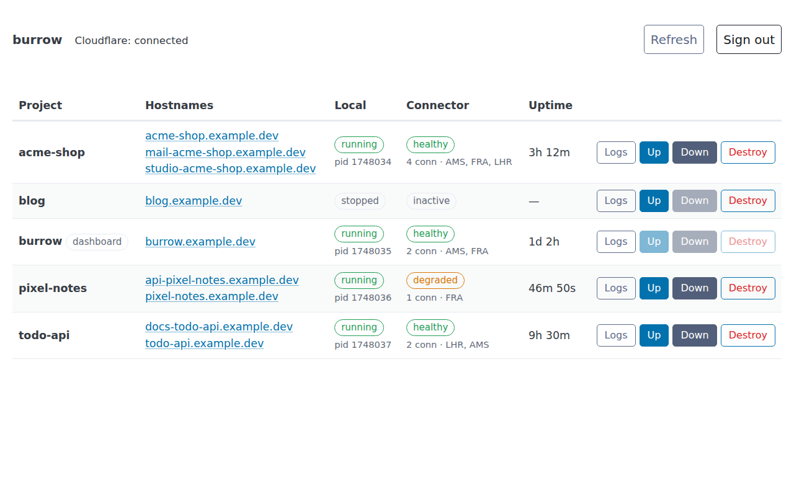
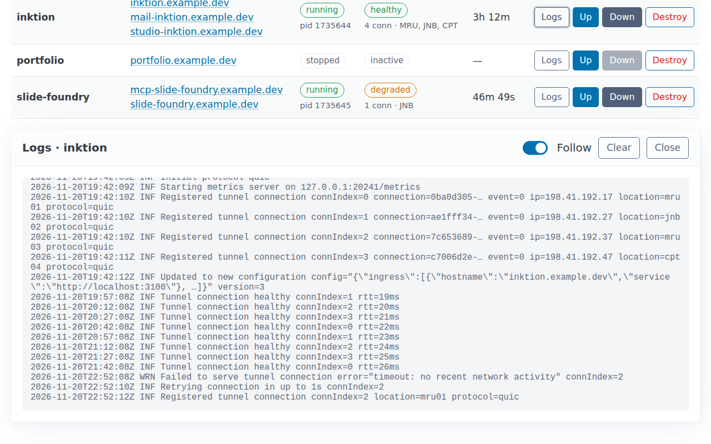

# burrow

`burrow` is a small CLI that exposes local projects through **Cloudflare Tunnel**.
It creates a remotely-managed tunnel, its ingress rules and the DNS records through
the Cloudflare API, and runs `cloudflared` in the background. `burrow down` stops it; `burrow destroy` removes
all of it, so no stale tunnels or CNAMEs are left behind.



## Naming rule

Only flat, one-level hostnames are used, so Cloudflare's free Universal SSL
certificate (`*.<domain>`) covers every hostname:

| Service            | Hostname                       |
| ------------------ | ------------------------------ |
| root (`app`)       | `<project>.<domain>`           |
| any other service  | `<service>-<project>.<domain>` |

Example with `BURROW_DOMAIN=example.dev`: `acme-shop.example.dev`,
`mail-acme-shop.example.dev`, `studio-acme-shop.example.dev`.

Cloudflare objects are named and tagged so burrow can find them again:

- tunnel: `burrow-<project>`
- DNS records: proxied `CNAME <host> -> <tunnel-id>.cfargotunnel.com` with comment `burrow:<project>`

## Install

Requires Node 18+ and [`cloudflared`](https://github.com/cloudflare/cloudflared/releases).
burrow isn't published to the npm registry (`"private": true`); install it from git or from a checkout.

From git (installs `burrow` globally, with its dependencies):

```sh
npm install -g git+ssh://git@github.com/<owner>/burrow.git        # or git+https://…
npm install -g git+ssh://git@github.com/<owner>/burrow.git#main   # a branch or tag
```

From a checkout (handy while hacking on it, since edits apply immediately):

```sh
git clone <this-repo-url> burrow && cd burrow
npm install
npm link          # or: npm install -g .
```

Check it with `burrow --version`. Remove it with `npm uninstall -g burrow` (or `npm unlink -g burrow`).

With nvm, global packages belong to the active Node version, so reinstall after switching
versions. The systemd unit (if you use one) records the Node binary path when it is installed.

## Setup

1. Add the tunnel domain to Cloudflare (it has to be an active zone).
2. Create an API token at **My Profile > API Tokens > Create Token > Custom token**:
   - **Account > Cloudflare Tunnel > Edit**
   - **Zone > DNS > Edit**, limited to the tunnel domain's zone
   - optional **Zone > Analytics > Read**, only for `burrow stats`
   - optional **Zone > Zone > Read**, only if you leave `CF_ZONE_ID` empty (used to look up the zone ID)
   - optional **Account > Access: Apps and Policies > Edit**, only for services with `private: true`
3. Run `burrow init`. It writes `~/.config/burrow/config.env` (mode 600):

   ```env
   CF_API_TOKEN=...
   CF_ACCOUNT_ID=...
   CF_ZONE_ID=          # optional
   BURROW_DOMAIN=example.dev
   BURROW_DASHBOARD_PASSWORD=...   # for burrow dashboard, 12+ characters
   BURROW_DASHBOARD_PORT=7070
   CLOUDFLARED_BIN=cloudflared
   ```

4. Fill it in and run `burrow init` again. It verifies the token
   (`/user/tokens/verify`) and checks tunnel and DNS access. The token is never printed.

Every value can also come from the environment. `BURROW_CONFIG` and
`BURROW_STATE_DIR` override the config file and state directory paths.

## tunnel.yml

Put a `tunnel.yml` in the project directory, or pass one with `-f`.

```yaml
project: acme-shop
services:
  - name: app                 # "app" is the root service (or set root: true on one service)
    url: http://localhost:3100
    paths:                    # path rules on the same hostname, checked first
      - { path: /auth/v1, url: http://localhost:54321 }
      - { path: /rest/v1, url: http://localhost:54321 }
      - { path: /storage/v1, url: http://localhost:54321 }
      - { path: /realtime/v1, url: http://localhost:54321 }
  - name: mail
    url: http://localhost:54324
  - name: studio
    url: http://localhost:54323
```

- `project` and `name` must be lowercase DNS labels with no dots.
- `domain: example.org` (optional) uses another Cloudflare zone on the same account for this project
  instead of `BURROW_DOMAIN` ([details](docs/domains.md)).
- `paths[].path` is a prefix. `/auth/v1` matches `/auth/v1` and everything below it.
  A value that starts with `^` is used as a raw regex.
- `originRequest` (on a service or a path) is passed through to cloudflared, e.g.
  `originRequest: { noTLSVerify: true }`.
- `private: true` on a service puts its hostname behind **Cloudflare Access** (login by email),
  allowing `allow: [you@example.dev, "@example.dev"]` or `BURROW_ACCESS_EMAILS`. Services stay
  public by default ([details](docs/access.md)).
- burrow adds a final `http_status:404` rule.
- `hooks:` runs shell commands in the project directory around `up` and `down` (`pre_up`, `post_up`,
  `pre_down`, `post_down`), e.g. start `next dev` in the background before the tunnel comes up
  ([details](docs/hooks.md)). `--no-hooks` skips them.
- `autostart: true` makes `burrow service` bring the project up at boot ([details](docs/service.md)).

See [`examples/acme-shop.tunnel.yml`](examples/acme-shop.tunnel.yml).

## Commands

| Command                          | What it does |
| -------------------------------- | ------------ |
| `burrow init`                    | Write the config template, or verify the token and access |
| `burrow update`                  | Update burrow itself: a git checkout gets `git pull --ff-only` + `npm install`, a global npm install is reinstalled from its git source; `--check` only reports newer commits ([details](docs/update.md)) |
| `burrow add [project]`           | Create a `tunnel.yml` by answering prompts, or non-interactively with `--app`, `--path`, `--service` ([details](docs/add.md)) |
| `burrow up [project]`            | Create or reuse tunnel `burrow-<project>`, PUT its ingress config, upsert the CNAMEs (and remove stale ones tagged for this project), then (re)start `cloudflared` in the background |
| `burrow edit [project]`          | Open `tunnel.yml` in `$EDITOR` (or `vi`/`nano`), validate it on save (a broken edit never replaces the file), and offer to re-run `up` if the project is running; `--yes`, `--no-apply` ([details](docs/edit.md)) |
| `burrow share <port>`            | Share a local port on a temporary `<random>.<domain>` hostname; Ctrl+C, `burrow down` or `burrow destroy` removes it ([details](docs/share.md)) |
| `burrow down [project]`          | Stop that project's `cloudflared` only. The tunnel and DNS records are kept, so the next `up` is quick |
| `burrow restart [project]`       | Re-sync the tunnel config and DNS and restart `cloudflared` (same as `up`, which reuses the tunnel). With no project, restarts every connector that is running now; `--dry-run` shows the plan. Detached shares are restarted on the same hostname, shares still attached to a `burrow share` in the foreground are skipped ([details](docs/share.md#restart-completion-and-export)) |
| `burrow down`                    | Stop **every** running burrow connector (each pid in `~/.local/state/burrow/`) |
| `burrow export [file]` / `burrow import <file>` | Export remembered project configs to YAML/JSON (tunnel.yml fields only, never tokens or passwords) and import them on another machine ([details](docs/export-import.md)) |
| `burrow destroy [project]`       | Stop `cloudflared`, delete DNS records tagged `burrow:<project>`, delete the tunnel's connections and the tunnel. `burrow down <project> --purge` does the same |
| `burrow url [project]` / `burrow open [project] [service]` | Print a project's `https://` URLs (`--plain` for URLs only), or open one in the browser (`$BROWSER`, `xdg-open` or `open`; `--print` just prints it). Inside a project directory `burrow open mail` opens the `mail` service |
| `burrow destroy --all`           | Delete every `burrow-*` tunnel and every `burrow:*` DNS record, and stop all local connectors. Asks `[y/N]` first; `--yes` skips the prompt (needed in non-interactive shells) |
| `burrow prune`                   | Find orphaned `burrow:*` DNS records and `burrow-*` tunnels with no local state; lists them and asks before deleting (`--dry-run`, `--yes`) ([details](docs/prune.md)) |
| `burrow dashboard`               | Run the web dashboard in the foreground on `127.0.0.1:7070` |
| `burrow doctor [project]`        | Check config, token, zone, cloudflared and whether each local service port answers; pass/fail per line ([details](docs/doctor.md)) |
| `burrow dashboard up`            | Start the dashboard in the background and expose it at `https://burrow.<domain>` through its own tunnel (`--no-tunnel` for local only) |
| `burrow service install\|uninstall\|status` | systemd user unit that runs `burrow up` at boot for projects with `autostart: true` or listed in `BURROW_AUTOSTART` ([details](docs/service.md)) |
| `burrow dashboard down`          | Stop the dashboard server and its tunnel connector (tunnel and DNS are kept) |
| `burrow completion bash\|zsh`    | Print a completion script for commands, options and project names. Add `source <(burrow completion zsh)` (or `bash`) to your shell rc file |
| `burrow dashboard status`        | Server, connector, URL, whether a password is set |
| `burrow ls`                      | List `burrow-*` tunnels with their hostnames and local running state (`--json` for a machine-readable array) |
| `burrow status [project]`        | Local process, tunnel health, DNS records (`--json` for an object with `running`, `pid`, `tunnel`, `records`) |
| `burrow stats [project]`         | Requests, bandwidth and 2xx/3xx/4xx/5xx counts per hostname from Cloudflare's GraphQL Analytics (`--since 24h`, `--json`). Needs **Zone > Analytics > Read** ([details](docs/stats.md)) |
| `burrow logs [project]`          | Show the cloudflared log (`-n 200`, `--follow`) |
| `burrow watch [projects...]`     | Check connectors, tunnel health and local service ports every `--interval` seconds and alert on changes through `BURROW_ALERT_WEBHOOK` (JSON; Slack/Discord-compatible) and/or `BURROW_ALERT_NTFY`; `--debounce`, `--once` for cron, `--install-service` for a systemd unit ([details](docs/alerts.md)) |

`destroy` with no project and no `--all` refuses to run.

Options:

- `-f, --file <path>` uses a specific tunnel.yml (and picks its project).
- `--dry-run` (`up`, `down`, `destroy`) prints the plan. `up` and `down` stay fully offline.
  `destroy --all --dry-run` lists what is on Cloudflare when a token is configured.
- `--force` (`up`) replaces existing DNS records on the same hostnames that burrow doesn't manage.
  Without it, burrow refuses to touch them.

`up` is idempotent, so run it again after editing tunnel.yml. Once a project has been
brought up, `burrow up <project>` works from any directory because burrow remembers
where its tunnel.yml lives.

State lives in `~/.local/state/burrow/`: `<project>.pid`, `<project>.log` and
`<project>.json` (tunnel id, file path). The tunnel token goes to cloudflared through
the `TUNNEL_TOKEN` environment variable. It is never written to disk or shown in `ps`.

## Dashboard

`burrow dashboard up` starts a small web UI and runs `burrow up` for a built-in project called `burrow`, which maps
`https://burrow.<domain>` to `http://localhost:<BURROW_DASHBOARD_PORT>`. Its tunnel is
`burrow-burrow` with DNS comment `burrow:burrow`, and `burrow` is reserved as a project name.

The server is Node's built-in `http`. The UI uses [Pico CSS](https://picocss.com) (automatic
light/dark theme) and [Alpine.js](https://alpinejs.dev) with **no build step**. Both are npm
dependencies pinned to exact versions (`@picocss/pico` 2.1.1, `@alpinejs/csp` 3.17.5). The
server serves them from `node_modules` at `/vendor/pico.min.css` and `/vendor/alpine.min.js`,
so the dashboard works offline and never loads anything from a CDN. It uses Alpine's
[CSP build](https://alpinejs.dev/advanced/csp), so the Content-Security-Policy needs neither
`'unsafe-eval'` nor `'unsafe-inline'` (`script-src 'self'; style-src 'self'`). All UI logic is
in `Alpine.data()` components in `src/dashboard/ui.js`.

It shows every burrow project with:

- clickable hostnames
- local cloudflared state (running/stopped, pid, uptime)
- connector status from the Cloudflare API (healthy/degraded/down, connections, colos)
- a live log viewer that streams `~/.local/state/burrow/<project>.log` over SSE
- **Up** / **Down** buttons and **Destroy…** (in the row's **⋯** menu). **Destroy** opens a dialog and stays disabled until you type the project name.
  The dashboard's own project can't be stopped from the UI.

| Sign in | Live logs |
| ------- | --------- |
|  |  |

The screenshots use fake demo data (`example.dev`, a mock Cloudflare API and made-up logs).

Security:

- The dashboard won't start unless `BURROW_DASHBOARD_PASSWORD` is set (12+ characters).
- The password is compared in constant time and is never logged. The login form posts with
  `fetch` (JSON), and a plain HTML form post still works without JavaScript.
- Sessions use an HMAC-signed, `HttpOnly; Secure; SameSite=Strict` cookie (12 h), also tracked
  server-side so **Sign out** really ends them. Restarting the server or changing the password
  signs everyone out.
- Logins are limited to 5 failed attempts per IP per 15 minutes (429 after that). Behind the
  tunnel the client IP comes from `CF-Connecting-IP`, which is trusted only from loopback.
- Every state-changing request needs an `X-Burrow: 1` header (CSRF protection). Responses carry a
  strict CSP, `X-Frame-Options: DENY` and `no-store`.
- The server binds to `127.0.0.1` by default, so it is reachable only through the tunnel or
  locally. Open it over HTTPS (or `http://localhost`), because the Secure cookie isn't sent over
  plain HTTP to other hosts.

### Panels

Dashboard features beyond the tunnel table are **panels**: one file each in
`src/dashboard/panels/`, loaded at start-up. A panel can add HTML at fixed slots (toolbar,
table cells, row buttons, sections, dialogs), an Alpine mixin, CSS, vendored files, API routes
and extra fields on `/api/tunnels`. Panel routes run only after the session check, and their
POSTs need the same `X-Burrow: 1` header, so every feature gets the same login, cookie and CSRF
protection. Commands the dashboard runs get `BURROW_SOURCE=dashboard` in their environment.
See [`src/dashboard/panels/README.md`](src/dashboard/panels/README.md) for the interface.

The table stays within the window with every panel merged: each row shows **Logs**, **Up** and
**Down**, and the rest (**Destroy…** and panel actions such as Edit, Stats and Restart) are in
the row's **⋯** menu. Long hostnames are shortened with an ellipsis (hover for the full name), the
Uptime column is hidden below 1240 px, and below 1180 px each project becomes a card, so it also
works on a phone. In card view, cells without an obvious meaning carry a small label (**Boot** in
front of the start-at-boot switch, **up** in front of the uptime).

### Add and edit projects

**New project** (top bar) and **Edit** (per row) open a form for the domain, the app port or URL,
extra paths on the app, sub-services and `autostart`. **Check** shows the hostnames and the
`tunnel.yml` it will write; **Save** validates it with the same rules as `burrow up` and can run
`burrow up` right after (on by default for new and running projects).

- New files go to `~/.config/burrow/projects/<project>.tunnel.yml` (where `burrow import` puts
  them) and are remembered, so **Up** works straight away. Existing names are refused.
- Edits go to the file `burrow up` remembered. They're made in place, so comments and keys the
  form doesn't show (`hooks`, `private`, `originRequest`, …) are kept. The
  dashboard's own project and shares can't be edited.
- **Domain** picks the project's zone ([per-project domains](docs/domains.md)). The default is
  `BURROW_DOMAIN`, which writes no `domain:` key. The list has the Cloudflare zones on the
  account (fetched with the dashboard's token, cached for 5 minutes, with a zone's status if it
  isn't active yet), zones burrow has cached, and domains other projects use. **Other domain…**
  takes any name. Changing an existing project's domain moves its hostnames: the next
  `burrow up` deletes the records in the old zone and creates them in the new one.
  `GET /api/domains` returns the choices.
- The browser never sends a file path.

**Rename…** in the edit form renames a project. Hostnames and the tunnel name are built from the
project name, so a rename really replaces the project in Cloudflare, and it's done the safe way:

1. The project must be stopped (**Down** first); the dialog shows every old → new hostname (on the
   project's own domain) before
   anything happens, and names already used locally or by a Cloudflare tunnel are refused.
2. `burrow destroy <old>` deletes the old tunnel and DNS records. If that fails, nothing else is
   changed.
3. Only `project:` in `tunnel.yml` changes (comments and other keys stay); a file in
   `~/.config/burrow/projects/` is renamed to `<new>.tunnel.yml`. The new name is remembered.
4. Optionally `burrow up <new>` creates the new tunnel and DNS records straight away.

Old URLs stop working. The old project's log file is kept under its old name.
`POST /api/projects/<old>/rename {to, confirm: true, up}`; `dryRun: true` only returns the plan.

### Local port health

Each hostname gets a dot for the local port behind it, checked every 10 s with a TCP connect
(the same check `burrow watch` uses; results are cached for 3 s):

- **green**: the port answers and the tunnel is up
- **red**: the app is down (nothing listening on its port; a service with paths is red if any of its ports is closed)
- **orange**: the app answers but the tunnel is down (cloudflared stopped, or no Cloudflare connections)
- **grey**: nothing to check (`http_status:…`) or no remembered `tunnel.yml`

Under the Local state a line says which it is, e.g. `app down: api :3001` or
`tunnel down: cloudflared stopped`. Hover a dot for the host and port.

### Request stats

**Stats** on a row opens requests, bandwidth and status classes per hostname for the last
hour, 6 hours, 24 hours or 7 days, plus an inline-SVG chart of requests with 4xx and 5xx lines
(15-minute buckets up to 6 h, hourly beyond). Pick a hostname to chart only that one. It uses the
same Cloudflare GraphQL Analytics query as `burrow stats`, so the token needs
**Zone > Analytics > Read**; without it the panel shows the permission error. Results are cached
for 60 s per project and window, and Cloudflare samples these numbers.

### Logs

The log viewer (**Logs** on a row, or **All logs** in the top bar for every tunnel at once):

- **Search** filters lines as you type (in the combined view it matches project names too).
- **Level** filter: all, info and up, warnings and errors, or errors only. Levels come from
  cloudflared's `DBG/INF/WRN/ERR` (and `level=…`); warnings and errors are coloured.
- **All logs** interleaves every `~/.local/state/burrow/*.log` by timestamp, tags each line with
  its project, and picks up projects that start logging later.
- **Download** saves the log as a file: the last 10 MB of one project, or the last 2 MB of each
  project merged into one file for **All logs**.

The viewer keeps the newest 3000 lines in the browser.

### Quick actions

Next to every hostname (hover to highlight) are three small icons: **copy** copies the URL, **open** (arrow out of a box) opens it in a new tab,
and **QR** shows a QR code to open it on a phone. The icons are inline SVG, so they look the same on every system and need no icon font. **Restart** on a row re-syncs `tunnel.yml` and
restarts cloudflared, like `burrow restart <project>` (not for the dashboard's own project).

The QR code is drawn in the browser by [qrcode-generator](https://github.com/kazuhikoarase/qrcode-generator)
(MIT, pinned to 2.0.4), served from `node_modules` at `/vendor/qrcode.js` and loaded the first time
you open a QR code, so it works offline and needs no CSP change (the image is a `data:` URL).
Copying uses the Clipboard API on HTTPS or localhost and falls back to a selection copy.

### Event history

**History** in the top bar lists what changed and when: `up`, `down`, `destroy`, `restart`,
`share`, `prune`, `add`, `edit`, `import`, `autostart`, `service install|uninstall`,
`dashboard up|down` and `update`, with the project, the result (ok/failed), how long it took and
where it came from:

- `cli`: you ran it in a shell
- `dashboard`: a button in the dashboard (the dashboard runs the CLI with `BURROW_SOURCE=dashboard`),
  or a dashboard-only action such as saving a `tunnel.yml` from the form
- `boot`: `burrow autostart` from the systemd unit

Dashboard **sign-in** (ok or wrong password, with the client IP) and **sign-out** are recorded
too, as `dashboard` events; the password never is. Attempts refused by the rate limit aren't.

A run that is cut short still leaves an entry, marked failed unless it exited with code 0:
`stopped by SIGINT` (Ctrl+C), `stopped by SIGTERM` / `SIGHUP`, or `exited before finishing`
when a command calls `process.exit()`. The exit code stays what it was (130 for Ctrl+C,
143 for SIGTERM), and a command with its own Ctrl+C cleanup (such as `share`) still runs it.
Only `kill -9` (SIGKILL) can't be caught and leaves no entry.

Filter by project or source. Read-only commands (`ls`, `status`, `logs`, `stats`, …) and
`--dry-run` aren't recorded. Events are JSON Lines in `~/.local/state/burrow/history/events.jsonl`
(mode 600, no secrets); past 1 MB the file is cut to the newest 2000 events. Recording is best
effort and never makes a command fail.

### Alerts

**Alerts** in the top bar configures [`burrow watch`](docs/alerts.md) from the browser:

- **Watcher**: install (or reinstall with a new interval and debounce) and uninstall the
  `burrow-watch.service` systemd user unit, with its current state. Uninstalling asks first.
- **Channels**: set or remove the webhook (Slack, Discord or JSON), the ntfy topic or URL, and
  the ntfy token. They're written to the burrow config file (kept at mode 600, other lines
  untouched) and never sent back to the browser or logged; the page only shows what kind of
  channel is set and its host. Values from the environment win over the file and are marked `(env)`.
- **Send test alert** delivers a `burrow-test is degraded` message to every channel and shows
  any delivery errors.
- **Last seen by the watcher** lists the state `burrow watch` keeps per project (status, since
  when, and a change it's still debouncing).

### Cleanup

**Cleanup** in the top bar scans Cloudflare for orphans with the same rules as
[`burrow prune`](docs/prune.md): `burrow-*` tunnels with no local state on this machine, and
`burrow:*` DNS records whose tunnel is gone, points elsewhere, or is an orphan itself. Tunnels with
live connections but no local state (probably another machine) are left out unless you switch on
**Include tunnels with live connections**.

Everything found is pre-selected; untick what you want to keep. **Delete** asks you to type
`delete`. The server then scans again and deletes only picks that are still orphans (the DNS
records of a deleted tunnel go with it), so an out-of-date page can't delete a live tunnel.

### Bulk actions and auto-start

Tick the checkboxes in front of projects (or the header box for all of them) and use **Start** / **Stop** in the toolbar. Projects run one after another, each with the same busy lock as the row buttons; the result lists every project and the call returns `207` when some failed. The built-in `burrow` project can't be picked.

The **Boot** switch sets `autostart: true` in the project's tunnel file (comments and other keys are kept). Projects listed in `BURROW_AUTOSTART` show a locked switch: change those in `~/.config/burrow/config.env`. Projects without a tunnel file can't be toggled.

The bar under the table shows the `burrow.service` systemd unit and which projects it brings up. **Install** runs `burrow service install --now`; **Uninstall** asks first, because systemd runs `burrow down` when it stops the unit (every connector stops, tunnels and DNS are kept).

Endpoints: `POST /api/bulk {action: up|down|restart, projects: [...]}` (at most 50), `POST /api/autostart/:project {enabled}`, `GET /api/boot`, `POST /api/boot {action: install|uninstall, confirm}`.

Server state lives in `~/.local/state/burrow/dashboard/server.{pid,log}`. A bare
`burrow down` also stops the dashboard's tunnel connector, so run `burrow dashboard up` to bring it back.

### Live updates

_Not merged yet (`feature/ui-live`)._

### Shares

_Not merged yet (`feature/ui-shares`)._

### Cloudflare Access

_Not merged yet (`feature/ui-access`)._

### Doctor

**Doctor** in the top bar runs `burrow doctor --json --all` on the server and lists every check
with a **pass**, **warning**, **fail** or **skipped** badge: the config file and its permissions,
`CF_API_TOKEN`, `CF_ACCOUNT_ID`, `BURROW_DOMAIN`, the token, zone, tunnel and DNS permissions
(through the Cloudflare API), cloudflared, and the local services of every remembered project.
Problems come with a **Fix** line (for example `chmod 600 …`, which token permission to add, or
which local URL to start). **Skip Cloudflare API checks** runs it offline. The last report is kept
until the dashboard restarts; one run at a time. Secrets are never part of the report.

On the command line, `burrow doctor --json` prints the same report as one JSON line
(`{ counts, checks: [{ section, status, label, detail, fix }] }`), and `--all` checks every
remembered project instead of `./tunnel.yml`.

### Uptime timeline

_Not merged yet (`feature/ui-uptime`)._

### Sessions and two-factor sign-in

**Sessions** in the toolbar lists the browsers signed in to the dashboard: browser and OS, IP,
when each signed in and when it was last active. Your own session is marked **this browser**.
You can sign out one session, **Sign out other sessions**, or **Sign out everywhere** (asks
first, and signs you out too). Sessions are listed by an opaque handle; session ids never leave
the server. Sessions still last 12 hours, and restarting the dashboard or changing its password
ends them all.

**Two-factor sign-in** is optional and off by default. Turning it on makes sign-in ask for a
6-digit code from an authenticator app (TOTP, SHA-1, 30 s; works with any common app):

1. Open **Sessions** and click **Set up two-factor sign-in**.
2. Scan the QR code with your app, or type the key shown under it. The key is shown only during
   setup. Once two-factor is on, the dashboard never shows or returns it again.
3. Enter the app's current code and click **Turn on**. A wrong code changes nothing. Setup
   expires after 15 minutes. **Sign out other sessions** is ticked by default.

From then on, the sign-in page has a code field. Each code works once, and the server accepts
the code before or after the current one, to allow for clock drift. Wrong codes count toward
the same limit as wrong passwords (5 per 15 minutes per IP). **Turn off** asks first and needs
a current code that hasn't been used yet. The key is stored in
`~/.local/state/burrow/dashboard/totp.json` (mode 600). If you lose the phone, delete that file
on the server to turn two-factor off ([details](docs/two-factor.md)).

| Endpoint | Does |
| --- | --- |
| `GET /api/sessions` | `sessions: [{handle, current, createdAt, lastSeen, ip, agent}]`, `twoFactor: {enabled, pending}` |
| `POST /api/sessions/revoke` | `{handle}` signs one session out |
| `POST /api/sessions/revoke-others` | Signs out every other session |
| `POST /api/sessions/revoke-all` | `{confirm: true}` signs out every session, this one included |
| `POST /api/two-factor/setup` | Starts setup; the only response that ever carries the key |
| `POST /api/two-factor/enable` | `{code, signOutOthers}` turns it on |
| `POST /api/two-factor/disable` | `{code, confirm: true}` turns it off and deletes the key |

### Backup and restore

_Not merged yet (`feature/ui-backup`)._

### Hooks and updates

_Not merged yet (`feature/ui-hooks-updates`)._

## Tests

`BURROW_CF_API_BASE` (environment only) points burrow at a mock Cloudflare API. It's used for
tests and for the README screenshots; leave it unset in normal use.

```sh
npm test
```
