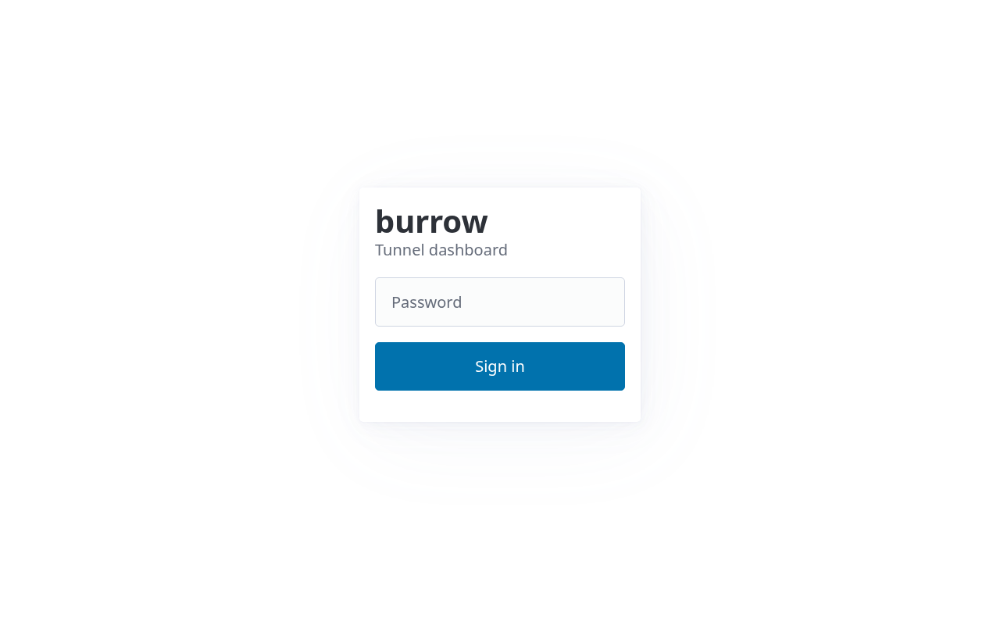

# burrow

`burrow` is a small CLI that exposes local projects through **Cloudflare Tunnel**.
It creates a remotely-managed tunnel, its ingress rules and the DNS records through
the Cloudflare API, and runs `cloudflared` in the background. `burrow down` stops it; `burrow destroy` removes
all of it, so no stale tunnels or CNAMEs are left behind.


## Naming rule

Only flat, one-level hostnames are used, so Cloudflare's free Universal SSL
certificate (`*.<domain>`) covers every hostname:

| Service            | Hostname                       |
| ------------------ | ------------------------------ |
| root (`app`)       | `<project>.<domain>`           |
| any other service  | `<service>-<project>.<domain>` |

Example with `BURROW_DOMAIN=example.dev`: `acme-shop.example.dev`,
`mail-acme-shop.example.dev`, `studio-acme-shop.example.dev`.

Cloudflare objects are named and tagged so burrow can find them again:

- tunnel: `burrow-<project>`
- DNS records: proxied `CNAME <host> -> <tunnel-id>.cfargotunnel.com` with comment `burrow:<project>`

## Install

Requires Node 18+ and [`cloudflared`](https://github.com/cloudflare/cloudflared/releases).
burrow isn't published to the npm registry (`"private": true`); install it from git or from a checkout.

From git (installs `burrow` globally, with its dependencies):

```sh
npm install -g git+ssh://git@github.com/<owner>/burrow.git        # or git+https://…
npm install -g git+ssh://git@github.com/<owner>/burrow.git#main   # a branch or tag
```

From a checkout (handy while hacking on it, since edits apply immediately):

```sh
git clone <this-repo-url> burrow && cd burrow
npm install
npm link          # or: npm install -g .
```

Check it with `burrow --version`. Remove it with `npm uninstall -g burrow` (or `npm unlink -g burrow`).

With nvm, global packages belong to the active Node version, so reinstall after switching
versions. The systemd unit (if you use one) records the Node binary path when it is installed.

## Setup

1. Add the tunnel domain to Cloudflare (it has to be an active zone).
2. Create an API token at **My Profile > API Tokens > Create Token > Custom token**:
   - **Account > Cloudflare Tunnel > Edit**
   - **Zone > DNS > Edit**, limited to the tunnel domain's zone
   - optional **Zone > Zone > Read**, only if you leave `CF_ZONE_ID` empty (used to look up the zone ID)
3. Run `burrow init`. It writes `~/.config/burrow/config.env` (mode 600):

   ```env
   CF_API_TOKEN=...
   CF_ACCOUNT_ID=...
   CF_ZONE_ID=          # optional
   BURROW_DOMAIN=example.dev
   BURROW_DASHBOARD_PASSWORD=...   # for burrow dashboard, 12+ characters
   BURROW_DASHBOARD_PORT=7070
   CLOUDFLARED_BIN=cloudflared
   ```

4. Fill it in and run `burrow init` again. It verifies the token
   (`/user/tokens/verify`) and checks tunnel and DNS access. The token is never printed.

Every value can also come from the environment. `BURROW_CONFIG` and
`BURROW_STATE_DIR` override the config file and state directory paths.

## tunnel.yml

Put a `tunnel.yml` in the project directory, or pass one with `-f`.

```yaml
project: acme-shop
services:
  - name: app                 # "app" is the root service (or set root: true on one service)
    url: http://localhost:3100
    paths:                    # path rules on the same hostname, checked first
      - { path: /auth/v1, url: http://localhost:54321 }
      - { path: /rest/v1, url: http://localhost:54321 }
      - { path: /storage/v1, url: http://localhost:54321 }
      - { path: /realtime/v1, url: http://localhost:54321 }
  - name: mail
    url: http://localhost:54324
  - name: studio
    url: http://localhost:54323
```

- `project` and `name` must be lowercase DNS labels with no dots.
- `paths[].path` is a prefix. `/auth/v1` matches `/auth/v1` and everything below it.
  A value that starts with `^` is used as a raw regex.
- `originRequest` (on a service or a path) is passed through to cloudflared, e.g.
  `originRequest: { noTLSVerify: true }`.
- burrow adds a final `http_status:404` rule.
- `hooks:` runs shell commands in the project directory around `up` and `down` (`pre_up`, `post_up`,
  `pre_down`, `post_down`), e.g. start `next dev` in the background before the tunnel comes up
  ([details](docs/hooks.md)). `--no-hooks` skips them.
- `autostart: true` makes `burrow service` bring the project up at boot ([details](docs/service.md)).

See [`examples/acme-shop.tunnel.yml`](examples/acme-shop.tunnel.yml).

## Commands

| Command                          | What it does |
| -------------------------------- | ------------ |
| `burrow init`                    | Write the config template, or verify the token and access |
| `burrow add [project]`           | Create a `tunnel.yml` by answering prompts, or non-interactively with `--app`, `--path`, `--service` ([details](docs/add.md)) |
| `burrow up [project]`            | Create or reuse tunnel `burrow-<project>`, PUT its ingress config, upsert the CNAMEs (and remove stale ones tagged for this project), then (re)start `cloudflared` in the background |
| `burrow share <port>`            | Share a local port on a temporary `<random>.<domain>` hostname; Ctrl+C, `burrow down` or `burrow destroy` removes it ([details](docs/share.md)) |
| `burrow down [project]`          | Stop that project's `cloudflared` only. The tunnel and DNS records are kept, so the next `up` is quick |
| `burrow restart [project]`       | Re-sync the tunnel config and DNS and restart `cloudflared` (same as `up`, which reuses the tunnel). With no project, restarts every connector that is running now; `--dry-run` shows the plan |
| `burrow down`                    | Stop **every** running burrow connector (each pid in `~/.local/state/burrow/`) |
| `burrow export [file]` / `burrow import <file>` | Export remembered project configs to YAML/JSON (tunnel.yml fields only, never tokens or passwords) and import them on another machine ([details](docs/export-import.md)) |
| `burrow destroy [project]`       | Stop `cloudflared`, delete DNS records tagged `burrow:<project>`, delete the tunnel's connections and the tunnel. `burrow down <project> --purge` does the same |
| `burrow url [project]` / `burrow open [project] [service]` | Print a project's `https://` URLs (`--plain` for URLs only), or open one in the browser (`$BROWSER`, `xdg-open` or `open`; `--print` just prints it). Inside a project directory `burrow open mail` opens the `mail` service |
| `burrow destroy --all`           | Delete every `burrow-*` tunnel and every `burrow:*` DNS record, and stop all local connectors. Asks `[y/N]` first; `--yes` skips the prompt (needed in non-interactive shells) |
| `burrow prune`                   | Find orphaned `burrow:*` DNS records and `burrow-*` tunnels with no local state; lists them and asks before deleting (`--dry-run`, `--yes`) ([details](docs/prune.md)) |
| `burrow dashboard`               | Run the web dashboard in the foreground on `127.0.0.1:7070` |
| `burrow doctor [project]`        | Check config, token, zone, cloudflared and whether each local service port answers; pass/fail per line ([details](docs/doctor.md)) |
| `burrow dashboard up`            | Start the dashboard in the background and expose it at `https://burrow.<domain>` through its own tunnel (`--no-tunnel` for local only) |
| `burrow service install\|uninstall\|status` | systemd user unit that runs `burrow up` at boot for projects with `autostart: true` or listed in `BURROW_AUTOSTART` ([details](docs/service.md)) |
| `burrow dashboard down`          | Stop the dashboard server and its tunnel connector (tunnel and DNS are kept) |
| `burrow completion bash\|zsh`    | Print a completion script for commands, options and project names. Add `source <(burrow completion zsh)` (or `bash`) to your shell rc file |
| `burrow dashboard status`        | Server, connector, URL, whether a password is set |
| `burrow ls`                      | List `burrow-*` tunnels with their hostnames and local running state (`--json` for a machine-readable array) |
| `burrow status [project]`        | Local process, tunnel health, DNS records (`--json` for an object with `running`, `pid`, `tunnel`, `records`) |
| `burrow logs [project]`          | Show the cloudflared log (`-n 200`, `--follow`) |

`destroy` with no project and no `--all` refuses to run.

Options:

- `-f, --file <path>` uses a specific tunnel.yml (and picks its project).
- `--dry-run` (`up`, `down`, `destroy`) prints the plan. `up` and `down` stay fully offline.
  `destroy --all --dry-run` lists what is on Cloudflare when a token is configured.
- `--force` (`up`) replaces existing DNS records on the same hostnames that burrow doesn't manage.
  Without it, burrow refuses to touch them.

`up` is idempotent, so run it again after editing tunnel.yml. Once a project has been
brought up, `burrow up <project>` works from any directory because burrow remembers
where its tunnel.yml lives.

State lives in `~/.local/state/burrow/`: `<project>.pid`, `<project>.log` and
`<project>.json` (tunnel id, file path). The tunnel token goes to cloudflared through
the `TUNNEL_TOKEN` environment variable. It is never written to disk or shown in `ps`.

## Dashboard

`burrow dashboard up` starts a small web UI and runs `burrow up` for a built-in project called `burrow`, which maps
`https://burrow.<domain>` to `http://localhost:<BURROW_DASHBOARD_PORT>`. Its tunnel is
`burrow-burrow` with DNS comment `burrow:burrow`, and `burrow` is reserved as a project name.

The server is Node's built-in `http`. The UI uses [Pico CSS](https://picocss.com) (automatic
light/dark theme) and [Alpine.js](https://alpinejs.dev) with **no build step**. Both are npm
dependencies pinned to exact versions (`@picocss/pico` 2.1.1, `@alpinejs/csp` 3.17.5). The
server serves them from `node_modules` at `/vendor/pico.min.css` and `/vendor/alpine.min.js`,
so the dashboard works offline and never loads anything from a CDN. It uses Alpine's
[CSP build](https://alpinejs.dev/advanced/csp), so the Content-Security-Policy needs neither
`'unsafe-eval'` nor `'unsafe-inline'` (`script-src 'self'; style-src 'self'`). All UI logic is
in `Alpine.data()` components in `src/dashboard/ui.js`.

It shows every burrow project with:

- clickable hostnames
- local cloudflared state (running/stopped, pid, uptime)
- connector status from the Cloudflare API (healthy/degraded/down, connections, colos)
- a live log viewer that streams `~/.local/state/burrow/<project>.log` over SSE
- **Up** / **Down** / **Destroy** buttons. **Destroy** opens a dialog and stays disabled until you type the project name.
  The dashboard's own project can't be stopped from the UI.

| Sign in | Live logs |
| ------- | --------- |
|  |  |

The screenshots use fake demo data (`example.dev`, a mock Cloudflare API and made-up logs).

Security:

- The dashboard won't start unless `BURROW_DASHBOARD_PASSWORD` is set (12+ characters).
- The password is compared in constant time and is never logged. The login form posts with
  `fetch` (JSON), and a plain HTML form post still works without JavaScript.
- Sessions use an HMAC-signed, `HttpOnly; Secure; SameSite=Strict` cookie (12 h), also tracked
  server-side so **Sign out** really ends them. Restarting the server or changing the password
  signs everyone out.
- Logins are limited to 5 failed attempts per IP per 15 minutes (429 after that). Behind the
  tunnel the client IP comes from `CF-Connecting-IP`, which is trusted only from loopback.
- Every state-changing request needs an `X-Burrow: 1` header (CSRF protection). Responses carry a
  strict CSP, `X-Frame-Options: DENY` and `no-store`.
- The server binds to `127.0.0.1` by default, so it is reachable only through the tunnel or
  locally. Open it over HTTPS (or `http://localhost`), because the Secure cookie isn't sent over
  plain HTTP to other hosts.

### Panels

Dashboard features beyond the tunnel table are **panels**: one file each in
`src/dashboard/panels/`, loaded at start-up. A panel can add HTML at fixed slots (toolbar,
table cells, row buttons, sections, dialogs), an Alpine mixin, CSS, vendored files, API routes
and extra fields on `/api/tunnels`. Panel routes run only after the session check, and their
POSTs need the same `X-Burrow: 1` header, so every feature gets the same login, cookie and CSRF
protection. Commands the dashboard runs get `BURROW_SOURCE=dashboard` in their environment.
See [`src/dashboard/panels/README.md`](src/dashboard/panels/README.md) for the interface.

### Add and edit projects

_Not merged yet (`feature/ui-project-form`)._

### Local port health

_Not merged yet (`feature/ui-health`)._

### Request stats

_Not merged yet (`feature/ui-stats`)._

### Logs

_Not merged yet (`feature/ui-logs`)._

### Quick actions

_Not merged yet (`feature/ui-quick-actions`)._

### Event history

_Not merged yet (`feature/ui-history`)._

### Alerts

_Not merged yet (`feature/ui-alerts`)._

### Cleanup

_Not merged yet (`feature/ui-cleanup`)._

### Bulk actions and auto-start

_Not merged yet (`feature/ui-bulk`)._

Server state lives in `~/.local/state/burrow/dashboard/server.{pid,log}`. A bare
`burrow down` also stops the dashboard's tunnel connector, so run `burrow dashboard up` to bring it back.

### Live updates

_Not merged yet (`feature/ui-live`)._

### Shares

_Not merged yet (`feature/ui-shares`)._

### Cloudflare Access

_Not merged yet (`feature/ui-access`)._

### Doctor

_Not merged yet (`feature/ui-doctor`)._

### Uptime timeline

_Not merged yet (`feature/ui-uptime`)._

### Sessions and two-factor sign-in

_Not merged yet (`feature/ui-sessions`)._

### Backup and restore

_Not merged yet (`feature/ui-backup`)._

### Hooks and updates

_Not merged yet (`feature/ui-hooks-updates`)._

## Tests

`BURROW_CF_API_BASE` (environment only) points burrow at a mock Cloudflare API. It's used for
tests and for the README screenshots; leave it unset in normal use.

```sh
npm test
```
